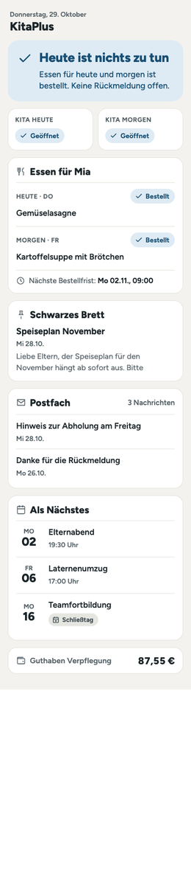
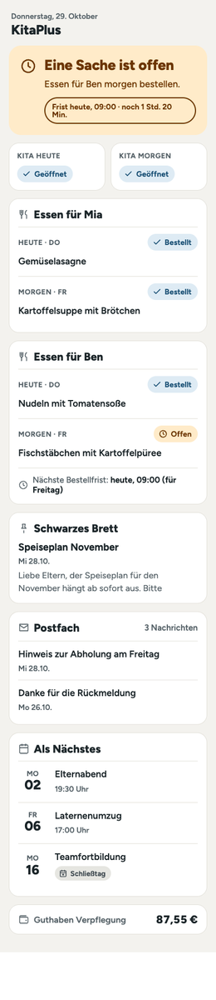
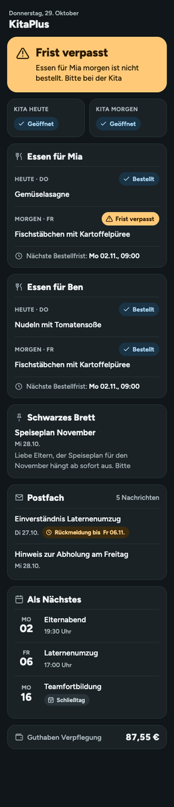
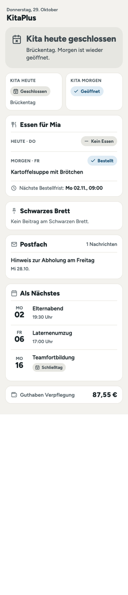

# KitaPlus for Home Assistant

🇩🇪 [Deutsche Version](README.md)

Unofficial Home Assistant integration for the **kitaplus parent app** (eltern.kitaplus.de), the app many German day-care centres (Kitas) use. It shows the bulletin board, mailbox, appointments and closure days, meal plan and orders, and the meal account balance in Home Assistant.

> **Important, please read**
> - This project is **not** from kitaplus and has no connection to kitaplus or your Kita.
> - There is no public API. The integration uses the same endpoints as the parent app in the browser. It can **stop working at any time after a kitaplus update**.
> - You use it **at your own risk**. Check whether the terms of use of your Kita or of kitaplus allow this kind of use.
> - The integration is **read-only**. It does not order, book, cancel or report anything.
> - The KitaPlus app itself is in German. Some names below (for example *Verpflegung → Hilfe → Bestellfristen*) are quoted as they appear in the app.

**Jump to:** [Installation](#installation) · [Setup](#setup-and-sign-in) · [Order deadlines](#order-deadlines) · [Blueprints](#blueprints) · [Dashboard](#dashboard-templates) · [Help](#troubleshooting) · [Wiki](https://github.com/dbl-mm/ha-kitaplus/wiki)

## What it looks like

> Design draft (mockups with made-up data, in German). In your Home Assistant it looks a little plainer, because colours, fonts and corner radii come from your theme. Real screenshots will follow.

   

## Features

- **Bulletin board:** latest title, the last 5 posts as attribute `posts`
- **Mailbox:** number of messages, the last 5 as attribute `messages`; **Pending replies**: messages that need a confirmation, with their deadline
- **Calendars:** **Appointments**, **Closures** (including public holidays) and, per child, **Ordered meals**; **Upcoming dates**: the next appointments and closure days in one list (attribute `entries`)
- **Kita:** **Closed today**, **Closed tomorrow** (attribute `reason` gives the reason, for example "Brückentag", a bridge day)
- **Meals:** per child **Meal today**, **Meal tomorrow**, **Order status today**, **Order status tomorrow** (Ordered, Open, Deadline missed, No meal), **Next order deadline**, **Nothing ordered tomorrow**; per account **Meal account balance** (EUR)
- **Diagnostics:** **Session valid until** (disabled by default): how long the stored sign-in is valid
- **Events:** `kitaplus_new_board_post`, `kitaplus_new_message` (with `id` and `title`; not on the first fetch), `kitaplus_order_deadline` (before the order deadline, see below)

Every child appears as its own device, plus a "KitaPlus" device for the account. New children appear without a restart (after 24 hours at the latest). Children KitaPlus no longer lists are removed as devices.

**Supported:** parent accounts of the kitaplus parent app with e-mail and password, including two-factor (authenticator app or e-mail code). It was tested with one account, one facility and one child. **Not supported:** accounts that sign in with a passkey only, and any write function.

## Quick start

1. Search for **KitaPlus** in HACS and download it, then restart Home Assistant. (If it does not show up in the search yet: [Installation](#installation).)
2. **Settings → Devices & services → Add integration → KitaPlus**, sign in with your KitaPlus account (e-mail and password, plus a two-factor code if needed).
3. Under **Configure**, enter **your Kita's order deadline**, so that "Deadline missed" and the reminders are right. [How to](#order-deadlines).
4. Import a [blueprint](#blueprints) and add the [dashboard](#dashboard-templates).

## Installation

### HACS (recommended)
1. Search for **KitaPlus** in HACS and download it.
2. Restart Home Assistant.
3. **Settings → Devices & services → Add integration → KitaPlus**.

If you cannot find KitaPlus in the search yet (new entries appear with a delay), add it as a **custom repository**: HACS → ⋮ → **Custom repositories** → `https://github.com/dbl-mm/ha-kitaplus`, category **Integration**.

### Manual
Copy the folder `custom_components/kitaplus` to `<config>/custom_components/kitaplus` and restart.

## Updates

Updates come through HACS like for any other integration: HACS creates an **update entity**, Home Assistant shows the update under **Settings → System → Updates**, and you install it with one click. After that you need to **restart Home Assistant**. The stored sign-in is kept, there is **no new sign-in** at KitaPlus.

> **Important: restart after every update.** Only after the restart does the new code run, and new entities (for example
> **Upcoming dates**) appear only then. Until you restart, Home Assistant keeps showing the old version.
> If you do not see the update: in HACS choose **⋮ → Reload data** or **Redownload** on KitaPlus, select the version,
> and restart Home Assistant. Which version is running is shown under *Settings → Devices & services → KitaPlus*.

What each version changes is listed in the [changelog](CHANGELOG.md) and in the [GitHub releases](https://github.com/dbl-mm/ha-kitaplus/releases). Versions follow [SemVer](https://semver.org/).

## Setup and sign-in

Fields of the setup:

- **E-mail address**: the e-mail of your KitaPlus parent account. It is sent exactly as you type it.
- **Password**: your KitaPlus password. It is used only to sign in and is **never stored**.
- **Code**: only if your account uses two-factor: the code from the authenticator app or the e-mail.

**Passkeys do not work.** If you have only signed in with a passkey so far, set a password in the KitaPlus app as well.

**To protect your account:**
- Every click on "Submit" is **exactly one** sign-in attempt. There are no automatic retries.
- After **2 failed attempts** the setup stops and **pauses for 15 minutes**, even if you reopen the dialog. Reason: KitaPlus can lock accounts after too many failed attempts, and only **the Kita management** can unlock one.
- KitaPlus' own message is shown to you unchanged, together with the counter ("Failed attempt 1 of 2").
- Server errors or maintenance at KitaPlus are recognised and **not** counted as wrong passwords.
- If the session later expires or is rejected, **the integration stops polling** and shows exactly what happened under **Settings → Repairs**. It does not sign in again by itself.

### Options
**Settings → Devices & services → KitaPlus → Configure:**

- **Polling interval** (default: 30 minutes): how often Home Assistant asks KitaPlus (15 to 240 minutes). Less than 15 is not allowed, to go easy on the servers.

### Reconfigure
**⋮ → Reconfigure** lets you sign in again or change the e-mail address. Only **the same KitaPlus account** is accepted; a different account is rejected and nothing is changed. The same protection rules apply as in the setup.

## Data updates

The integration asks KitaPlus at the set interval (every 30 minutes by default). One run consists of a few read requests: appointments for this and the next month, the meal plan for the next 14 days per child, bulletin board, mailbox and accounts. The list of children is reloaded only once a day. Before the first fetch after a restart, the access token is renewed with the stored refresh token. **No password** is needed for that.

"Today" and "tomorrow" values are recalculated at midnight, without a new request.

## Order deadlines

Every Kita decides **until when** meals can be ordered or cancelled. Some use "1 day before the meal at 11:00", others "until 9:00 on the same day". KitaPlus only gives the time in the help text of the app, not as a number. The integration therefore works with **two pieces of information**:

1. **What KitaPlus reports:** per meal, the server says whether it can **still be ordered**.
2. **Your Kita's deadline:** the integration reads it from KitaPlus itself, once a day. Then everything is accurate to the minute. You can also enter it yourself, which takes priority.

The four states of the order status:

- **Ordered**: something is ordered.
- **Open**: there is a meal, nothing is ordered, and it can **still** be ordered.
- **Deadline missed**: there is a meal, nothing is ordered, and the deadline is **over**. Nothing can be changed any more.
- **No meal**: no meal is offered that day.

### Your Kita's deadline
You normally do not have to do anything: the integration reads the sentence from the KitaPlus app ("… 1 Tage vor Essenausgabe um 11:00 Uhr") itself. The sensor **Next order deadline** shows whether that worked in its attribute `rule_source` (`kitaplus`). If it cannot understand the sentence, it shows `null` and you enter the deadline yourself. It is in the KitaPlus app under *Verpflegung → Hilfe → Bestellfristen*, for example:

> Bestellfrist (Einzelbestellungen): **1 Tage vor Essenausgabe um 11:00 Uhr**. Einzelbestellungen für den heutigen Tag (Donnerstag) müssen bis spätestens Mittwoch, 28.10.2026 um 11:00 Uhr vorgenommen worden sein.
>
> (In English: order deadline for single orders: **1 day before the meal at 11:00**. Single orders for today (Thursday) must be placed by Wednesday, 28.10.2026 at 11:00 at the latest.)

To override it or enter it: *Settings → Devices & services → KitaPlus → Configure*.

- **Order deadline: days before the meal** (example: `1`): `0` means on the day itself. Leave empty if you do not know it.
- **Order deadline: time** (example: `11:00`): the time at which ordering closes.
- **Move the deadline off weekends and holidays** (example: on): switch on if your Kita moves a deadline that falls on a Saturday, Sunday or public holiday back to the previous workday (a Monday meal then closes on Friday). If the KitaPlus help text says so ("… auf den vorhergehenden Werktag verschoben …"), it is already set for you.
- **Reminder before the deadline (minutes)** (example: `120`): how long before the deadline the reminder fires. `0` turns it off.

With the deadline entered:
- The **order status** switches to "Deadline missed" **exactly at the deadline**, even if the last fetch is older.
- The sensor **Next order deadline** shows when the next order closes.
- **Before the deadline** the integration fires the event `kitaplus_order_deadline`, but only if the day is not ordered yet. It fetches **fresh data first**. The blueprint "Reminder shortly before the order deadline" turns that into a notification.
- Public holidays are taken from the KitaPlus appointments (Kita closure days do not count). If your Kita moves a deadline from a weekend or holiday to the workday before, the integration does the same.

**Without a known deadline** (nothing entered and the KitaPlus sentence not readable), only what KitaPlus reports counts. It is as current as the last fetch (every 30 minutes by default). The blueprint "Reminder at fixed times" therefore fetches fresh data before every reminder, and you set its time **well before** your deadline.

After a missed deadline, blueprints and dashboard do **not** ask you to order. The integration **never orders or cancels by itself**. Future ordering functions may also only act while KitaPlus reports the meal as orderable, and must report success or failure unambiguously.

**Event `kitaplus_order_deadline`:** `child`, `child_id`, `day`, `days_ahead`, `weekday` (0 = Monday), `deadline`, `minutes_left` and `fresh` (`false` if KitaPlus was not reachable and the last known state was used).

## Use cases

- **Do not forget to order meals:** remind yourself in the evening when **Nothing ordered tomorrow** is on.
- **Closure days:** do not wake anyone up, or plan the childcare backup, when **Closed today** or **Closed tomorrow** is on.
- **News from the bulletin board or mailbox:** send a notification to your phone from the event.
- **Keep an eye on the balance:** a warning when the **account balance** falls below a value.
- **Family calendar:** **Appointments**, **Closures** and **Ordered meals** appear as calendars and can be shown in the dashboard.

## Examples

Reminder when nothing is ordered for tomorrow:
```yaml
automation:
  - alias: "Kita: order meal"
    triggers:
      - trigger: time
        at: "18:00:00"
    conditions:
      - condition: state
        entity_id: sensor.child_order_status_tomorrow
        state: "open"
    actions:
      - action: notify.notify
        data:
          message: "No meal is ordered for tomorrow."
```

Notification for a new bulletin board post:
```yaml
automation:
  - alias: "Kita: new post"
    triggers:
      - trigger: event
        event_type: kitaplus_new_board_post
    actions:
      - action: notify.notify
        data:
          message: "Kita: {{ trigger.event.data.title }}"
```

Entity IDs depend on your child's name. Check them under Settings → Entities.

## Blueprints

Ready-made automations: you only choose **what** you want to know and **how** you want to be notified (phone notification, speech output, …). A click on the button opens **your** Home Assistant instance and imports the blueprint; nothing is created before that. You pick the entities from a list.

> The blueprints are written in **German**: their names and the texts of their fields are German. They work the same regardless of your Home Assistant language. English translations of the names are given below, so you can find the right one.

**Which one do I need?** For most families **"Erinnerung kurz vor der Bestellfrist"** is enough. Everything else is optional.

### Ordering meals

- **KitaPlus: Erinnerung kurz vor der Bestellfrist** (reminder shortly before the order deadline, *recommended*): a message shortly before ordering closes, but only if nothing is ordered yet. You set how much earlier (for example 2 hours). For this you enter your Kita's deadline once (see [Order deadlines](#order-deadlines)).
  **[Import into Home Assistant](https://my.home-assistant.io/redirect/blueprint_import/?blueprint_url=https%3A%2F%2Fgithub.com%2Fdbl-mm%2Fha-kitaplus%2Fblob%2Fmain%2Fblueprints%2Fautomation%2Fkitaplus%2Fbestellfrist_erinnerung.yaml)**

- **KitaPlus: Erinnerung zu festen Uhrzeiten** (reminder at fixed times): the same with fixed times, for example every evening at 18:00 for tomorrow. Only needed if you do not want to enter a deadline.
  **[Import into Home Assistant](https://my.home-assistant.io/redirect/blueprint_import/?blueprint_url=https%3A%2F%2Fgithub.com%2Fdbl-mm%2Fha-kitaplus%2Fblob%2Fmain%2Fblueprints%2Fautomation%2Fkitaplus%2Fessen_erinnerung.yaml)**

### Notifications

- **KitaPlus: Neue Mitteilung** (new notice): a message for every new bulletin board post or new mailbox message, optionally only for certain keywords.
  **[Import into Home Assistant](https://my.home-assistant.io/redirect/blueprint_import/?blueprint_url=https%3A%2F%2Fgithub.com%2Fdbl-mm%2Fha-kitaplus%2Fblob%2Fmain%2Fblueprints%2Fautomation%2Fkitaplus%2Fneue_mitteilung.yaml)**

- **KitaPlus: Offene Rückmeldungen** (pending replies): reminds you of messages you have to confirm or answer, with title and deadline.
  **[Import into Home Assistant](https://my.home-assistant.io/redirect/blueprint_import/?blueprint_url=https%3A%2F%2Fgithub.com%2Fdbl-mm%2Fha-kitaplus%2Fblob%2Fmain%2Fblueprints%2Fautomation%2Fkitaplus%2Frueckmeldung_erinnerung.yaml)**

### Kita and account

- **KitaPlus: Schließtag** (closure day): a heads-up the evening before that the Kita is closed tomorrow (with the reason). In the morning something else can happen too, for example the alarm clock stays off.
  **[Import into Home Assistant](https://my.home-assistant.io/redirect/blueprint_import/?blueprint_url=https%3A%2F%2Fgithub.com%2Fdbl-mm%2Fha-kitaplus%2Fblob%2Fmain%2Fblueprints%2Fautomation%2Fkitaplus%2Fschliesstag.yaml)**

- **KitaPlus: Niedriges Guthaben** (low balance): a warning when the meal account balance falls below an amount.
  **[Import into Home Assistant](https://my.home-assistant.io/redirect/blueprint_import/?blueprint_url=https%3A%2F%2Fgithub.com%2Fdbl-mm%2Fha-kitaplus%2Fblob%2Fmain%2Fblueprints%2Fautomation%2Fkitaplus%2Fguthaben_niedrig.yaml)**

- **KitaPlus: Tagesbriefing** (daily briefing): a single message in the morning with the essentials: closures, meals, pending replies, balance.
  **[Import into Home Assistant](https://my.home-assistant.io/redirect/blueprint_import/?blueprint_url=https%3A%2F%2Fgithub.com%2Fdbl-mm%2Fha-kitaplus%2Fblob%2Fmain%2Fblueprints%2Fautomation%2Fkitaplus%2Ftagesbriefing.yaml)**

- **KitaPlus: Anmeldung läuft ab** (sign-in expires): a notice a few days before you have to sign in to KitaPlus again.
  **[Import into Home Assistant](https://my.home-assistant.io/redirect/blueprint_import/?blueprint_url=https%3A%2F%2Fgithub.com%2Fdbl-mm%2Fha-kitaplus%2Fblob%2Fmain%2Fblueprints%2Fautomation%2Fkitaplus%2Fsitzung_laeuft_ab.yaml)**

More on this, the available variables and an example: [docs/blueprints.md](docs/blueprints.md) (German). If the button does not work for you (for example without [My Home Assistant](https://my.home-assistant.io/)): *Settings → Automations & scenes → Blueprints → Import blueprint* and paste the address of the file from [`blueprints/automation/kitaplus/`](blueprints/automation/kitaplus).

## Dashboard templates

A deliberately calm dashboard in the new sections layout, using only built-in cards, in German and English: **Heute** (today: one status card that says what matters, Kita, meals per child, board, mailbox, appointments, balance), **Wand** (wall: tablet, three columns) and **Kalender** (calendar). Plus single cards to paste into your own dashboard. Setup in two minutes: [dashboards/README.md](dashboards/README.md). The English file is [`dashboards/kitaplus_en.yaml`](dashboards/kitaplus_en.yaml). The design rules are in [docs/dashboards.md](docs/dashboards.md) (German). If you want a designer to style it: [designer briefing](docs/designer-briefing.md) (German).

## Attachments (for example the menu plan)

If a file is attached to a bulletin board post or a message (often the menu plan as a PDF), the dashboard shows "Anhang: …" (attachment) as a link on the latest post. It opens the file in a new tab; the integration fetches it with your KitaPlus sign-in. The links are **signed by Home Assistant and expire**, they are not permanent public addresses. PDFs and images are displayed, other file types are only offered as a download. The names are also in the attribute `attachments` of the **Bulletin board** and **Mailbox** sensors.

## Troubleshooting

What you see and what it means:

- **Repair "Anmeldung abgelehnt" (sign-in rejected)**: KitaPlus rejected the stored session. Check your password in the KitaPlus app and sign in once more via **⋮ → Reconfigure**. Do not try several times.
- **Repair "Zugang gesperrt" (access locked)**: KitaPlus locked the account. Only **the Kita management** can unlock it. Home Assistant stops polling.
- **"Paused for 15 minutes"**: too many failed attempts. This protects your account. Check your credentials in the KitaPlus app and try afterwards.
- **Message about maintenance**: not a password problem. Home Assistant tries again automatically later.
- **"Unexpected response format"**: KitaPlus has probably changed. Share the diagnostics file in an [issue](https://github.com/dbl-mm/ha-kitaplus/issues).
- **Entities "unavailable"**: the last fetch failed (internet, maintenance). Look at the log; the next successful fetch brings them back.
- **New child is missing**: the list of children is refreshed daily. Reload the integration to refresh it right away.
- **Cannot sign in with a passkey**: set a password in the KitaPlus app.

**Share the diagnostics file:** Settings → Devices & services → KitaPlus → ⋮ → **Download diagnostics**. Names, texts, IDs, tokens and bank data are redacted. Still check the file before you upload it.

## Removal

1. **Settings → Devices & services → KitaPlus → ⋮ → Delete.** This removes all devices and entities.
2. In HACS: KitaPlus → ⋮ → **Remove**, then restart Home Assistant (or delete the folder `custom_components/kitaplus` for a manual installation).
3. The stored sign-in is deleted with the entry. If the KitaPlus app shows a device list for your account, you can remove the "Home Assistant" entry there (not verified).

## Privacy and security

- Home Assistant stores only your **e-mail address**, the **account number** and the **refresh token**. The **password is never stored**.
- No data is sent to third parties. The integration talks only to `eappbroker.kitaplus.de` over HTTPS.
- Data that is not needed (contacts, addresses, birth dates, documents) is discarded right after the fetch and neither stored nor displayed.
- The **diagnostics file** redacts names, texts, IDs, tokens and bank data.
- Please report vulnerabilities privately, see [SECURITY.md](SECURITY.md).

## Known limitations
- Read-only. Planned: sick notes and ordering and cancelling meals, each with an unambiguous report of success or failure.
- "Mailbox" counts all messages, not only unread ones.
- Guest children and multiple facilities are untested.
- The interface is undocumented and can change without notice.
- New children appear by themselves after 24 hours at the latest.

What may come next is in the [roadmap](https://github.com/dbl-mm/ha-kitaplus/blob/main/ROADMAP.md) (German).

## Quality scale

By its own assessment, the integration meets all rules of the [Home Assistant Quality Scale](https://www.home-assistant.io/docs/quality_scale/) up to **Platinum**. This is a **self-assessment**: Home Assistant only awards the tiers to integrations in core, and this one is distributed through HACS only. Every rule is listed with status and reasoning in [`quality_scale.yaml`](custom_components/kitaplus/quality_scale.yaml). CI runs `mypy --strict`, 95 % coverage per module (currently 100 %), hassfest and HACS on every change.

## Development

```bash
uv venv --python 3.13
uv pip install pytest-homeassistant-custom-component aioresponses pytest-cov mypy ruff
.venv/bin/python -m pytest
.venv/bin/mypy --strict custom_components/kitaplus
```

The tests run only with **anonymised** sample data (`tests/fixtures`) and make **no network requests**. Raw data never belongs in the repository; `docs/_raw/` is excluded via `.gitignore`. `scripts/anonymize_fixtures.py` creates the fixtures, `scripts/privacy_scan.py` checks before every commit that no real data is included. API notes are in [docs/api.md](docs/api.md) (German).

### Publish a new version
```bash
python3 scripts/bump_version.py 0.2.0        # sets the version in manifest.json, the blueprints and dashboards
# extend CHANGELOG.md, commit and push, then:
git tag v0.2.0 && git push origin v0.2.0     # starts .github/workflows/release.yml
```
The workflow checks that the tag matches `manifest.json`, runs the tests, builds `kitaplus.zip` and creates the GitHub release. Only then does the update appear in HACS.

### Versions in blueprints and dashboards
Every blueprint ends its description with "Version X · benötigt KitaPlus ab Y · Home Assistant ab Z" (needs KitaPlus from Y, Home Assistant from Z), and every dashboard file starts with a comment "Version X · benötigt KitaPlus ab Y". X is the version of the release the file comes from. Y is the oldest version of the integration the file works with. After updating the integration, check whether you should re-import the blueprints and the dashboard too: if the file shows a newer version than yours, importing again helps. `bump_version.py` writes these details, and the tests fail if one is out of date.

## License
[MIT](LICENSE)
