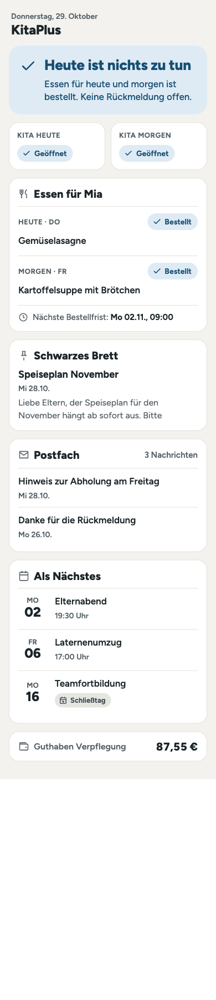
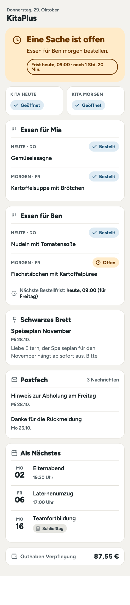
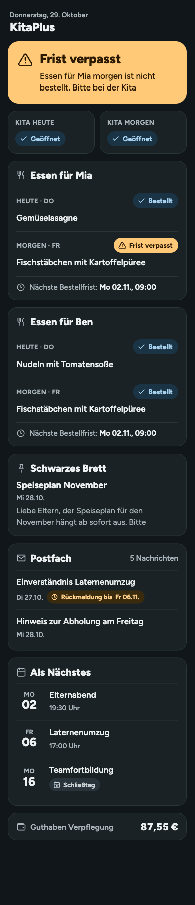
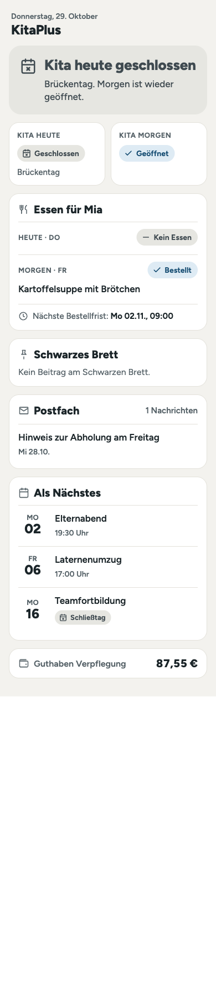

<picture>
  <source media="(prefers-color-scheme: dark)" srcset="custom_components/kitaplus/brand/dark_logo@2x.png">
  
</picture>

# KitaPlus für Home Assistant

Inoffizielle Home-Assistant-Integration für die **kitaplus Eltern-App** (eltern.kitaplus.de). Sie zeigt Schwarzes Brett, Postfach, Termine und Schließtage, Speiseplan und Bestellungen sowie den Verpflegungs-Kontostand in Home Assistant an.

<br clear="left">

> **Wichtig, bitte lesen**
> - Dieses Projekt ist **nicht** von kitaplus und steht in keiner Verbindung zu kitaplus oder deiner Kita.
> - Es gibt keine öffentliche API. Die Integration nutzt dieselben Schnittstellen wie die Eltern-App im Browser. Sie kann **jederzeit nach einem Update von kitaplus aufhören zu funktionieren**.
> - Die Nutzung geschieht **auf eigene Verantwortung**. Prüfe, ob die Nutzungsbedingungen deiner Kita bzw. von kitaplus eine solche Nutzung erlauben.
> - Die Integration ist **nur lesend**. Es wird nichts bestellt, gebucht, abbestellt oder gemeldet.

## Funktionen

| Bereich | Entities |
|---|---|
| Schwarzes Brett | **Schwarzes Brett**: neuester Titel, die letzten 5 Beiträge als Attribut `posts` |
| Postfach | **Postfach**: Anzahl der Nachrichten, die letzten 5 als Attribut `messages`; **Offene Rückmeldungen**: Nachrichten, die bestätigt werden müssen, mit Frist |
| Kalender | **Termine**, **Schließtage** (inkl. Feiertage) und pro Kind **Bestelltes Essen**; **Nächste Termine**: die nächsten Termine und Schließtage in einer Liste (Attribut `entries`) |
| Kita | **Heute geschlossen**, **Morgen geschlossen** (Attribut `reason` nennt den Grund, zum Beispiel „Brückentag“) |
| Verpflegung | pro Kind **Essen heute**, **Essen morgen**, **Bestellstatus heute**, **Bestellstatus morgen** (Bestellt, Offen, Frist verpasst, Kein Essen), **Nächste Bestellfrist**, **Morgen nicht bestellt**; pro Konto **Kontostand Verpflegung** (EUR) |
| Diagnose | **Sitzung gültig bis** (standardmäßig deaktiviert): bis wann die gespeicherte Anmeldung gilt |
| Ereignisse | `kitaplus_new_board_post`, `kitaplus_new_message` (mit `id` und `title`; nicht beim ersten Abruf), `kitaplus_order_deadline` (vor der Bestellfrist, siehe unten) |

Jedes Kind erscheint als eigenes Gerät, dazu ein Gerät „KitaPlus“ für das Konto. Neue Kinder erscheinen ohne Neustart (spätestens nach 24 Stunden), Kinder, die KitaPlus nicht mehr nennt, werden als Gerät entfernt.

**Unterstützt:** Eltern-Zugänge der kitaplus Eltern-App mit E-Mail und Passwort, auch mit Zwei-Faktor (Authenticator-App oder E-Mail-Code). Getestet wurde mit einem Konto, einer Einrichtung und einem Kind. **Nicht unterstützt:** Konten, die sich nur per Passkey anmelden, sowie jede schreibende Funktion.

## Installation

### HACS (empfohlen)
1. HACS → ⋮ → **Benutzerdefinierte Repositories** → `https://github.com/dbl-mm/ha-kitaplus`, Kategorie **Integration**.
2. „KitaPlus“ installieren und Home Assistant neu starten.
3. **Einstellungen → Geräte & Dienste → Integration hinzufügen → KitaPlus**.

### Manuell
Den Ordner `custom_components/kitaplus` nach `<config>/custom_components/kitaplus` kopieren und neu starten.

## Updates

Über HACS bekommst du Updates wie bei jeder anderen Integration: HACS legt eine **Update-Entität** an, Home Assistant zeigt unter **Einstellungen → System → Updates** ein Update an, und du installierst es mit einem Klick. Danach ist ein **Neustart von Home Assistant** nötig. Die gespeicherte Anmeldung bleibt erhalten, es gibt **keine neue Anmeldung** bei KitaPlus.

> **Wichtig: nach jedem Update neu starten.** Erst nach dem Neustart läuft der neue Code, und neue Entitäten (zum Beispiel
> **Nächste Termine**) erscheinen erst dann. Solange nicht neu gestartet wurde, zeigt Home Assistant weiter die alte Version.
> Siehst du das Update nicht: in HACS bei KitaPlus **⋮ → Daten neu laden** bzw. **Neu herunterladen** wählen, die Version
> auswählen und danach Home Assistant neu starten. Welche Version läuft, steht unter *Einstellungen → Geräte & Dienste → KitaPlus*.

Was jede Version ändert, steht im [Changelog](CHANGELOG.md) und in den [GitHub-Releases](https://github.com/dbl-mm/ha-kitaplus/releases). Versionen folgen [SemVer](https://semver.org/lang/de/).

## Einrichtung und Anmeldung

Felder der Einrichtung:

| Feld | Bedeutung |
|---|---|
| E-Mail-Adresse | Die E-Mail deines KitaPlus-Eltern-Zugangs. Sie wird genau so gesendet, wie du sie eingibst. |
| Passwort | Dein KitaPlus-Passwort. Es wird nur für die Anmeldung verwendet und **nie gespeichert**. |
| Code | Nur wenn dein Konto Zwei-Faktor nutzt: der Code aus der Authenticator-App oder der E-Mail. |

**Passkeys funktionieren nicht.** Wer sich bisher nur per Passkey anmeldet, setzt in der KitaPlus-App zusätzlich ein Passwort.

**Zum Schutz deines Kontos gilt:**
- Jeder Klick auf „Absenden“ ist **genau ein** Anmeldeversuch. Es gibt keine automatischen Wiederholungen.
- Nach **2 Fehlversuchen** bricht die Einrichtung ab und **pausiert 15 Minuten**, auch wenn du den Dialog neu öffnest. Grund: KitaPlus kann Konten nach zu vielen Fehlversuchen sperren. Eine Sperre kann **nur die Kita-Leitung** aufheben.
- Die Meldung von KitaPlus wird dir unverändert angezeigt, dazu der Zählerstand („Fehlversuch 1 von 2“).
- Serverfehler oder Wartungsarbeiten bei KitaPlus werden erkannt und **nicht** als Passwortfehler gezählt.
- Läuft die Sitzung später ab oder wird sie abgelehnt, **stoppt die Integration die Abfragen** und zeigt unter **Einstellungen → Reparaturen** genau an, was passiert ist. Sie meldet sich nicht von selbst neu an.

### Optionen
**Einstellungen → Geräte & Dienste → KitaPlus → Konfigurieren:**

| Option | Standard | Bedeutung |
|---|---|---|
| Abfrageintervall | 30 Minuten | Wie oft Home Assistant bei KitaPlus nachfragt (15 bis 240 Minuten). Weniger als 15 ist nicht erlaubt, um die Server zu schonen. |

### Neu konfigurieren
**⋮ → Neu konfigurieren** erlaubt, sich erneut anzumelden oder die E-Mail-Adresse zu ändern. Es wird nur **dasselbe KitaPlus-Konto** akzeptiert; ein anderes Konto wird abgelehnt und nichts verändert. Es gelten dieselben Schutzregeln wie bei der Einrichtung.

## Datenaktualisierung

Die Integration fragt KitaPlus im eingestellten Intervall ab (Standard alle 30 Minuten). Ein Durchlauf besteht aus wenigen Lese-Abfragen: Termine für diesen und den nächsten Monat, der Speiseplan der nächsten 14 Tage je Kind, Schwarzes Brett, Postfach und Konten. Die Kinderliste wird nur einmal pro Tag neu geladen. Vor dem ersten Abruf nach einem Neustart wird das Zugriffstoken mit dem gespeicherten Refresh-Token erneuert. Dabei ist **kein Passwort** nötig.

„Heute“- und „Morgen“-Werte werden um Mitternacht neu berechnet, ohne dass eine neue Abfrage nötig ist.

## Bestellfristen

Jede Kita legt selbst fest, **bis wann** Essen bestellt oder abbestellt werden kann. Bei manchen gilt „1 Tag vor Essenausgabe um 11:00 Uhr“, bei anderen „bis 9:00 Uhr am selben Tag“. KitaPlus verrät die Uhrzeit nur im Hilfetext der App, nicht als Zahl. Die Integration arbeitet deshalb mit **zwei Angaben**:

1. **Was KitaPlus meldet:** Pro Mahlzeit sagt der Server, ob sie **noch bestellbar** ist.
2. **Was du einträgst (empfohlen):** die Frist deiner Kita, einmal. Dann wird alles auf die Minute genau.

| Bestellstatus | Bedeutung |
|---|---|
| **Bestellt** | Es ist etwas bestellt. |
| **Offen** | Es gibt Essen, nichts ist bestellt, und es kann **noch** bestellt werden. |
| **Frist verpasst** | Es gibt Essen, nichts ist bestellt, und die Frist ist **vorbei**. Daran lässt sich nichts mehr ändern. |
| **Kein Essen** | An diesem Tag wird kein Essen angeboten. |

### Die Frist deiner Kita eintragen
Die Frist steht in der KitaPlus-App unter *Verpflegung → Hilfe → Bestellfristen*, zum Beispiel:

> Bestellfrist (Einzelbestellungen): **1 Tage vor Essenausgabe um 11:00 Uhr**. Einzelbestellungen für den heutigen Tag (Donnerstag) müssen bis spätestens Mittwoch, 28.10.2026 um 11:00 Uhr vorgenommen worden sein.

Trage sie unter *Einstellungen → Geräte & Dienste → KitaPlus → Konfigurieren* ein:

| Feld | Beispiel (obige Kita) | Bedeutung |
|---|---|---|
| Bestellfrist: Tage vor dem Essen | `1` | `0` heißt am Tag selbst. Leer lassen, wenn du sie nicht kennst. |
| Bestellfrist: Uhrzeit | `11:00` | Zeitpunkt, zu dem die Bestellung schließt. |
| Nur Werktage zählen | aus | Einschalten, wenn die Kita Samstag und Sonntag nicht mitzählt (Montag schließt dann am Freitag). Ob das bei dir so ist, siehst du im Beispielsatz der App an einem Montag. |
| Erinnerung vor der Frist (Minuten) | `120` | Wie lange vor der Frist erinnert wird. `0` schaltet die Erinnerung aus. |

Mit der Frist passiert Folgendes:
- Der **Bestellstatus** springt **genau zur Frist** auf „Frist verpasst“, auch wenn der letzte Abruf älter ist.
- Der Sensor **Nächste Bestellfrist** zeigt, wann die nächste Bestellung schließt.
- Die Integration löst **vor der Frist** das Ereignis `kitaplus_order_deadline` aus, aber nur, wenn der Tag noch nicht bestellt ist. Sie holt dafür **vorher frische Daten**. Der Blueprint „Erinnerung kurz vor der Bestellfrist“ macht daraus eine Mitteilung.
- Öffentliche Feiertage kennt die Integration nicht. Zählt deine Kita sie bei der Frist mit, verlässt sich der Status dann auf die Angabe von KitaPlus.

**Ohne eingetragene Frist** gilt nur die Angabe von KitaPlus. Sie ist so aktuell wie der letzte Abruf (Standard alle 30 Minuten). Der Blueprint „Erinnerung zu festen Uhrzeiten“ holt deshalb vor jeder Erinnerung frische Daten, und du stellst seine Uhrzeit **deutlich vor** deiner Frist ein.

Nach verpasster Frist fordern Blueprint und Dashboard **nicht** zum Bestellen auf. Die Integration **bestellt oder storniert nie selbst**. Auch künftige Bestell-Funktionen dürfen nur handeln, solange KitaPlus die Mahlzeit als bestellbar meldet, und müssen Erfolg oder Fehler eindeutig zurückmelden.

**Ereignis `kitaplus_order_deadline`:** `child`, `child_id`, `day`, `days_ahead`, `weekday` (0 = Montag), `deadline`, `minutes_left` und `fresh` (`false`, wenn KitaPlus gerade nicht erreichbar war und der letzte Stand verwendet wurde).

## Anwendungsfälle

- **Nicht vergessen, Essen zu bestellen:** Abends erinnern, wenn **Morgen nicht bestellt** an ist.
- **Schließtage:** Morgens nicht wecken oder das Betreuungs-Backup einplanen, wenn **Heute geschlossen** oder **Morgen geschlossen** an ist.
- **Neues vom Schwarzen Brett oder aus dem Postfach:** per Ereignis eine Mitteilung aufs Handy schicken.
- **Guthaben im Blick:** Hinweis, wenn der **Kontostand** unter einen Wert fällt.
- **Familienkalender:** **Termine**, **Schließtage** und **Bestelltes Essen** erscheinen als Kalender und lassen sich im Dashboard anzeigen.

## Beispiele

Erinnerung, wenn morgen nichts bestellt ist:
```yaml
automation:
  - alias: "Kita: Essen bestellen"
    triggers:
      - trigger: time
        at: "18:00:00"
    conditions:
      - condition: state
        entity_id: sensor.kind_bestellstatus_morgen
        state: "open"
    actions:
      - action: notify.notify
        data:
          message: "Für morgen ist kein Essen bestellt."
```

Mitteilung bei neuem Beitrag am Schwarzen Brett:
```yaml
automation:
  - alias: "Kita: neuer Beitrag"
    triggers:
      - trigger: event
        event_type: kitaplus_new_board_post
    actions:
      - action: notify.notify
        data:
          message: "Kita: {{ trigger.event.data.title }}"
```

Die Entity-IDs hängen vom Namen deines Kindes ab. Prüfe sie unter Einstellungen → Entitäten.

## Blueprints

Fertige Automationen: Du wählst nur aus, **was** du wissen willst und **wie** du benachrichtigt werden möchtest (Mitteilung aufs
Handy, Sprachausgabe …). Ein Klick auf den Knopf öffnet **deine** Home-Assistant-Instanz und importiert den Blueprint; vorher
wird nichts angelegt. Die Entities suchst du aus einer Liste aus. In Home Assistant heißen sie **„KitaPlus: …“**, genau wie unten.

**Welchen brauche ich?** Für die meisten Familien genügt **„Erinnerung kurz vor der Bestellfrist“**. Alles andere ist optional.

### Essen bestellen

| Blueprint | Wofür | Importieren |
|---|---|---|
| **Erinnerung kurz vor der Bestellfrist** *(empfohlen)* | Eine Nachricht kurz bevor die Bestellung schließt, aber nur, wenn noch nichts bestellt ist. Du stellst ein, wie viel früher (zum Beispiel 2 Stunden). Dafür trägst du einmal die Frist deiner Kita ein (siehe [Bestellfristen](#bestellfristen)). | <a href="https://my.home-assistant.io/redirect/blueprint_import/?blueprint_url=https%3A%2F%2Fgithub.com%2Fdbl-mm%2Fha-kitaplus%2Fblob%2Fmain%2Fblueprints%2Fautomation%2Fkitaplus%2Fbestellfrist_erinnerung.yaml"></a> |
| **Erinnerung zu festen Uhrzeiten** | Dasselbe mit festen Uhrzeiten, zum Beispiel jeden Abend um 18:00 für morgen. Nur nötig, wenn du keine Frist eintragen möchtest. | <a href="https://my.home-assistant.io/redirect/blueprint_import/?blueprint_url=https%3A%2F%2Fgithub.com%2Fdbl-mm%2Fha-kitaplus%2Fblob%2Fmain%2Fblueprints%2Fautomation%2Fkitaplus%2Fessen_erinnerung.yaml"></a> |

### Mitteilungen

| Blueprint | Wofür | Importieren |
|---|---|---|
| **Neue Mitteilung** | Eine Nachricht bei jedem neuen Beitrag am Schwarzen Brett oder jeder neuen Nachricht im Postfach, auf Wunsch nur bei bestimmten Stichwörtern. | <a href="https://my.home-assistant.io/redirect/blueprint_import/?blueprint_url=https%3A%2F%2Fgithub.com%2Fdbl-mm%2Fha-kitaplus%2Fblob%2Fmain%2Fblueprints%2Fautomation%2Fkitaplus%2Fneue_mitteilung.yaml"></a> |
| **Offene Rückmeldungen** | Erinnert an Nachrichten, die du bestätigen oder beantworten musst, mit Titel und Frist. | <a href="https://my.home-assistant.io/redirect/blueprint_import/?blueprint_url=https%3A%2F%2Fgithub.com%2Fdbl-mm%2Fha-kitaplus%2Fblob%2Fmain%2Fblueprints%2Fautomation%2Fkitaplus%2Frueckmeldung_erinnerung.yaml"></a> |

### Kita und Konto

| Blueprint | Wofür | Importieren |
|---|---|---|
| **Schließtag** | Am Vorabend ein Hinweis, dass die Kita morgen geschlossen ist (mit Grund). Am Morgen kann zusätzlich etwas passieren, zum Beispiel der Wecker ausgehen. | <a href="https://my.home-assistant.io/redirect/blueprint_import/?blueprint_url=https%3A%2F%2Fgithub.com%2Fdbl-mm%2Fha-kitaplus%2Fblob%2Fmain%2Fblueprints%2Fautomation%2Fkitaplus%2Fschliesstag.yaml"></a> |
| **Niedriges Guthaben** | Eine Warnung, wenn das Verpflegungs-Guthaben unter einen Betrag fällt. | <a href="https://my.home-assistant.io/redirect/blueprint_import/?blueprint_url=https%3A%2F%2Fgithub.com%2Fdbl-mm%2Fha-kitaplus%2Fblob%2Fmain%2Fblueprints%2Fautomation%2Fkitaplus%2Fguthaben_niedrig.yaml"></a> |
| **Tagesbriefing** | Eine einzige Nachricht am Morgen mit dem Wichtigsten: Schließtage, Essen, offene Rückmeldungen, Guthaben. | <a href="https://my.home-assistant.io/redirect/blueprint_import/?blueprint_url=https%3A%2F%2Fgithub.com%2Fdbl-mm%2Fha-kitaplus%2Fblob%2Fmain%2Fblueprints%2Fautomation%2Fkitaplus%2Ftagesbriefing.yaml"></a> |
| **Anmeldung läuft ab** | Ein Hinweis einige Tage, bevor du dich bei KitaPlus neu anmelden musst. | <a href="https://my.home-assistant.io/redirect/blueprint_import/?blueprint_url=https%3A%2F%2Fgithub.com%2Fdbl-mm%2Fha-kitaplus%2Fblob%2Fmain%2Fblueprints%2Fautomation%2Fkitaplus%2Fsitzung_laeuft_ab.yaml"></a> |

Mehr dazu, die verfügbaren Variablen und ein Beispiel: [docs/blueprints.md](docs/blueprints.md). Funktioniert der Knopf bei dir nicht
(zum Beispiel ohne [My Home Assistant](https://my.home-assistant.io/)): *Einstellungen → Automatisierungen & Szenen → Blueprints →
Blueprint importieren* und die Adresse der Datei aus [`blueprints/automation/kitaplus/`](blueprints/automation/kitaplus) einfügen.

## Dashboard-Vorlagen

Ein bewusst ruhiges Dashboard im neuen Sections-Layout, nur mit eingebauten Karten, auf Deutsch und Englisch:
**Heute** (eine Statuskarte, die das Wichtigste sagt; Kita; Essen pro Kind; Brett, Postfach, Termine, Guthaben), **Wand** (Tablet, drei Spalten) und
**Kalender**. Dazu einzelne Karten zum Einfügen in dein eigenes Dashboard. Einbau in zwei Minuten:
[dashboards/README.md](dashboards/README.md). Die Gestaltungsregeln stehen in [docs/dashboards.md](docs/dashboards.md). Wenn du es
von einem Designer gestalten lassen möchtest: [Briefing für Designer](docs/designer-briefing.md).

## So sieht es aus

> Entwurf des Designs (Mockups mit erfundenen Daten). In deinem Home Assistant wirkt es etwas schlichter, weil Farben, Schriften und Rundungen von deinem Theme kommen. Echte Bildschirmfotos folgen.

<p>




</p>

## Anhänge (zum Beispiel der Menüplan)

Ist an einem Beitrag am Schwarzen Brett oder an einer Nachricht eine Datei angehängt (oft der Menüplan als PDF), zeigt das Dashboard beim neuesten Beitrag „Anhang: …“ als Link. Er öffnet die Datei in einem neuen Tab, die Integration holt sie dafür mit deiner Anmeldung bei KitaPlus. Die Links sind von Home Assistant **signiert und laufen ab**, sie sind keine dauerhaften öffentlichen Adressen. Angezeigt werden PDF und Bilder, andere Dateitypen werden nur zum Download angeboten. Die Namen stehen auch im Attribut `attachments` der Sensoren **Schwarzes Brett** und **Postfach**.

## Fehlerbehebung

| Was du siehst | Bedeutung und Lösung |
|---|---|
| Reparatur „Anmeldung abgelehnt“ | KitaPlus hat die gespeicherte Sitzung abgelehnt. Prüfe dein Passwort in der KitaPlus-App und melde dich über **⋮ → Neu konfigurieren** einmal neu an. Nicht mehrfach probieren. |
| Reparatur „Zugang gesperrt“ | KitaPlus hat das Konto gesperrt. Nur die **Kita-Leitung** kann entsperren. Home Assistant fragt nichts mehr ab. |
| „Pausiert für 15 Minuten“ | Zu viele Fehlversuche. Das schützt dein Konto. Prüfe die Zugangsdaten in der KitaPlus-App und versuche es danach. |
| Meldung über Wartungsarbeiten | Kein Passwortproblem. Home Assistant versucht es später automatisch erneut. |
| „Unerwartetes Antwortformat“ | KitaPlus hat sich vermutlich geändert. Teile die Diagnose-Datei in einem [Issue](https://github.com/dbl-mm/ha-kitaplus/issues). |
| Entities „nicht verfügbar“ | Der letzte Abruf ist fehlgeschlagen (Internet, Wartung). Schau ins Protokoll; beim nächsten erfolgreichen Abruf sind sie wieder da. |
| Neues Kind fehlt | Die Kinderliste wird täglich aktualisiert. Zum sofortigen Aktualisieren die Integration neu laden. |
| Anmeldung mit Passkey nicht möglich | Setze in der KitaPlus-App ein Passwort. |

**Diagnose-Datei teilen:** Einstellungen → Geräte & Dienste → KitaPlus → ⋮ → **Diagnose herunterladen**. Namen, Texte, IDs, Token und Bankdaten sind geschwärzt. Prüfe die Datei trotzdem, bevor du sie hochlädst.

## Entfernen

1. **Einstellungen → Geräte & Dienste → KitaPlus → ⋮ → Löschen.** Damit werden alle Geräte und Entities entfernt.
2. In HACS: KitaPlus → ⋮ → **Entfernen**, danach Home Assistant neu starten (oder bei manueller Installation den Ordner `custom_components/kitaplus` löschen).
3. Die gespeicherte Anmeldung wird mit dem Eintrag gelöscht. Falls die KitaPlus-App eine Geräteliste zu deinem Konto anzeigt, kannst du dort den Eintrag „Home Assistant“ entfernen (nicht geprüft).

## Datenschutz und Sicherheit

- Gespeichert werden in Home Assistant nur deine **E-Mail-Adresse**, die **Konto-Nummer** und das **Refresh-Token**. Das **Passwort wird nie gespeichert**.
- Es werden keine Daten an Dritte gesendet. Die Integration spricht ausschließlich mit `eappbroker.kitaplus.de` über HTTPS.
- Daten, die nicht gebraucht werden (Kontakte, Adressen, Geburtsdaten, Dokumente), werden sofort nach dem Abruf verworfen und weder gespeichert noch angezeigt.
- Die **Diagnostics-Datei** schwärzt Namen, Texte, IDs, Token und Bankdaten.
- Schwachstellen bitte privat melden, siehe [SECURITY.md](SECURITY.md).

## Bekannte Einschränkungen
- Nur lesend. Geplant: Krankmeldung sowie Essen bestellen und abbestellen, jeweils mit eindeutiger Rückmeldung über Erfolg oder Fehler.
- „Postfach“ zählt alle Nachrichten, nicht nur ungelesene.
- Gastkinder und mehrere Einrichtungen sind nicht getestet.
- Die Schnittstelle ist nicht dokumentiert und kann sich ohne Vorwarnung ändern.
- Neue Kinder erscheinen spätestens nach 24 Stunden von selbst.

## Qualitätsstufe

Die Integration erfüllt nach eigener Prüfung alle Regeln der [Home Assistant Quality Scale](https://www.home-assistant.io/docs/quality_scale/) bis **Platinum**. Das ist eine **Selbsteinstufung**: Home Assistant vergibt die Stufen nur für Integrationen im Core, diese hier wird nur über HACS verteilt. Jede Regel steht mit Status und Begründung in [`quality_scale.yaml`](custom_components/kitaplus/quality_scale.yaml). Die CI prüft `mypy --strict`, 95 % Abdeckung je Modul (aktuell 100 %), hassfest und HACS bei jeder Änderung.

## Entwicklung

```bash
uv venv --python 3.13
uv pip install pytest-homeassistant-custom-component aioresponses pytest-cov mypy ruff
.venv/bin/python -m pytest
.venv/bin/mypy --strict custom_components/kitaplus
```

Die Tests laufen ausschließlich mit **anonymisierten** Beispieldaten (`tests/fixtures`) und machen **keine Netzwerkzugriffe**. Rohdaten gehören nie ins Repository; `docs/_raw/` ist per `.gitignore` ausgeschlossen. `scripts/anonymize_fixtures.py` erzeugt die Fixtures, `scripts/privacy_scan.py` prüft vor jedem Commit, dass keine echten Daten enthalten sind. API-Notizen stehen in [docs/api.md](docs/api.md).

### Neue Version veröffentlichen
```bash
python3 scripts/bump_version.py 0.2.0        # setzt die Version in manifest.json
# CHANGELOG.md ergänzen, committen und pushen, dann:
git tag v0.2.0 && git push origin v0.2.0     # startet .github/workflows/release.yml
```
Der Workflow prüft, dass Tag und `manifest.json` übereinstimmen, lässt die Tests laufen, baut `kitaplus.zip` und erstellt das GitHub-Release. Erst damit erscheint das Update in HACS.

## Lizenz
[MIT](LICENSE)

---

*English summary:* Unofficial, read-only Home Assistant integration for the kitaplus parent app. It uses the app's own endpoints, which can change at any time. Sign-in is one attempt per submit, pauses for 15 minutes after two failures, shows KitaPlus' own message, and never stores your password. Use at your own risk.
